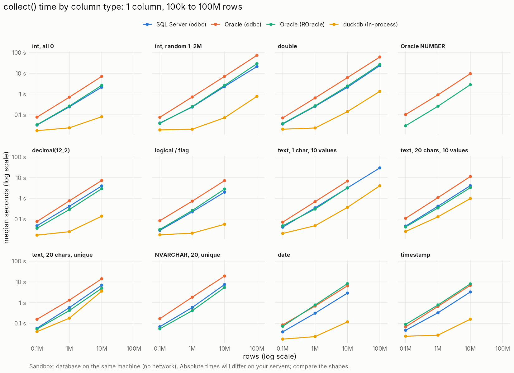

# collect() by column type × rows × columns

Script: `03-collect-types-rows-cols.R` → `results/03-collect.csv`, `results/03-r-types.csv`. Every case is `tbl(con, "bm_<type>_<rows>_<k>") |> collect()` in a fresh R process: the median of 2 to 5 calls after one warm-up (see [00-method.md](00-method.md)).

## Short version

- **Time grows in a straight line with rows**, for every type and engine: 10× the rows takes 10× the time, from 100k to 100M. There's no cliff (as long as it fits in RAM).
- **Rows cost more than values.** The odbc package fetches one row per ODBC call. So 1 column × 10M rows is the slowest way to move 10M values: as 100k rows × 100 columns it's **2 to 3 times faster** (table below).
- **Numbers all cost about the same.** int, double and logical are within ±10% of each other on every engine. **All-zeros vs random 1-2 million: no difference** for collect (it does matter for file sizes, see 05).
- **Text is the expensive type.** Unique 20-character strings cost 2 to 3 times as much as an int. Half of that is R itself creating 10M strings: duckdb, with no driver, still needs 3.6 s.
- **Few distinct values is cheaper than unique values** (`chr20_lo` vs `chr20_hi`). R keeps one copy of each distinct string, so 10 distinct values in 10M rows means 10 strings plus 10M pointers.
- **The driver matters more than the type:**
  - Oracle via **odbc is ~3× slower than SQL Server via odbc** per row.
  - Oracle via **ROracle is as fast as SQL Server**, except for dates (3× slower than its own numbers).
- **Decimal** (`DECIMAL(12,2)`) is 1.7× an int on SQL Server. Oracle's unconstrained `NUMBER` is 1.4× `BINARY_DOUBLE` through odbc.
- **Memory:** budget about **2× the final size of numeric columns** while collecting (odbc's buffers double as rows arrive). Unique strings: about 1.1 to 1.3×.

## What type does R get? (`results/03-r-types.csv`)

| what you store | SQL Server, odbc | Oracle, odbc | Oracle, ROracle | duckdb |
|---|---|---|---|---|
| integer (`INT` / `NUMBER(10)`) | integer | **double** | **double** | integer |
| double (`FLOAT` / `BINARY_DOUBLE`, `NUMBER`) | double | double | double | double |
| decimal (`DECIMAL(12,2)` / `NUMBER(12,2)`) | double | double | double | double |
| flag (`BIT` / `NUMBER(1)`) | logical | **double** | **integer** | logical |
| Oracle 26ai `BOOLEAN` | - | **error** (`Invalid SQL data type <-25>`) | **error** | - |
| text (`VARCHAR`, `NVARCHAR`) | character | character | character | character |
| date (`DATE`) | Date | **POSIXct** (Oracle DATE has a time) | **POSIXct** | Date |
| timestamp (`DATETIME2` / `TIMESTAMP`) | POSIXct | POSIXct | POSIXct | POSIXct |

- On Oracle, everything numeric is a double in R: twice the memory of an integer. `mutate(x = as.integer(x))` after collect, if it matters.
- Oracle `DATE` arrives as POSIXct. `as.Date()` it after collect, or keep it and remember the time part.
- Oracle 19c has no BOOLEAN, so the 26ai error won't bite you there.

## Seconds per collect, 1 column × 10M rows, and relative to an int on the same engine

| type | SQL Server | Oracle odbc | Oracle ROracle | duckdb |
|---|---|---|---|---|
| int, random 1-2M | 2.32 (1.0) | 7.13 (1.0) | 2.63 (1.0) | 0.07 |
| int, all 0 | 2.14 (0.9) | 7.13 (1.0) | 2.62 (1.0) | 0.08 |
| double | 2.13 (0.9) | 6.22 (0.9) | 2.45 (0.9) | 0.14 |
| logical / flag | 2.00 (0.9) | 7.17 (1.0) | 2.81 (1.1) | 0.06 |
| decimal(12,2) | 3.97 (1.7) | 7.28 (1.0) | 2.92 (1.1) | 0.14 |
| Oracle NUMBER (unconstrained) | - | 9.64 (1.4) | 2.83 (1.1) | - |
| text, 1 char, 10 values | 3.20 (1.4) | 6.85 (1.0) | 3.19 (1.2) | 0.37 |
| text, 20 chars, 10 values | 4.08 (1.8) | 11.30 (1.6) | 3.28 (1.2) | 0.98 |
| text, 20 chars, all unique | 6.98 (3.0) | 14.21 (2.0) | 4.93 (1.9) | 3.60 |
| NVARCHAR, 20 chars, unique | 7.50 (3.2) | 19.27 (2.7) | 5.43 (2.1) | - |
| date | 2.90 (1.3) | 6.49 (0.9) | **8.29 (3.2)** | 0.12 |
| timestamp | 3.28 (1.4) | 6.86 (1.0) | **8.08 (3.1)** | 0.16 |

At 100M rows (1 column): SQL Server int 21 s, double 24 s, 1-char text 30 s. Oracle odbc int 74 s, double 61 s. ROracle 29 s / 27 s. duckdb 0.8 s / 1.4 s. The 100M-row text table wasn't made on Oracle (Oracle Free's 12 GB cap).

## Rows vs columns: the same 10M int values, different shapes (seconds)

| shape | SQL Server | Oracle odbc | Oracle ROracle | duckdb |
|---|---|---|---|---|
| 10M rows × 1 column | 2.32 | 7.13 | 2.63 | 0.07 |
| 1M rows × 10 columns | 1.22 | 3.44 | 1.03 | 0.08 |
| 100k rows × 100 columns | 1.04 | 3.23 | 0.80 | 0.08 |

Nanoseconds per value. Wide tables flatten out at about 95 (SQL Server), 310 (Oracle odbc) and 70 (ROracle):

| table | columns | SQL Server | Oracle odbc | ROracle | duckdb |
|---|---|---|---|---|---|
| int, 1M rows | 1 | 235 | 720 | 246 | 20 |
| | 2 | 154 | 524 | 142 | 17 |
| | 10 | 122 | 344 | 103 | 8 |
| | 100 | 94 | 312 | 71 | 7 |
| double, 1M rows | 1 | 254 | 647 | 268 | 23 |
| | 10 | 110 | 297 | 98 | 21 |
| | 100 | 92 | 239 | 74 | 13 |
| text (10 values), 1M rows | 1 | 418 | 1089 | 344 | 129 |
| | 10 | 318 | 708 | 165 | 103 |

- From these, roughly: **SQL Server ~140 ns per row + ~95 ns per value; Oracle odbc ~410 + ~310; ROracle ~180 + ~70** (numbers, this machine).
- What it means for you: **filtering rows on the server pays off in full, dropping columns a bit less.** Keeping 1 of 10 int columns cut the time by ~80% (1.22 s to 0.24 s at 1M rows), not 90%, because each row still costs its fixed part. Keeping 1 row in 10 cuts it by 90%.

## Memory (1 column × 10M rows): size of the result in R / how much the process's peak grew during the first collect (MB)

| type | SQL Server | Oracle odbc | ROracle | duckdb |
|---|---|---|---|---|
| int | 40 / 91 | 80 / 180 (double!) | 80 / 151 | 40 / 105 |
| double | 80 / 179 | 80 / 180 | 80 / 151 | 80 / 224 |
| text, 10 values | 80 / 179 | 80 / 180 | 80 / **380** | 80 / **428** |
| text, unique | 880 / 966 | 880 / 968 | 880 / 1164 | 880 / 1277 |

At 100M doubles (800 MB) the peak grew by 1.5 GB (odbc, ROracle) to 2.2 GB (duckdb). That is the number to compare with your pod's memory limit.

## The first collect in a fresh R session

For most types, the first call in a fresh process was within 5 to 40% of the later ones. For **10M unique strings, the first call took 1.9 to 2.4× as long** (SQL Server 13.2 s vs 7.0 s; ROracle 10.9 vs 4.9; duckdb 8.8 vs 3.6). Of the extra ~6 s, ~4.7 s was R's garbage collector running again and again while the heap grew to hold 10M new strings. In a scheduled job that pulls one big table, that first number is the one you'll see. [07](07-driver-knobs.md) part f tests R's start-up GC settings for it.
