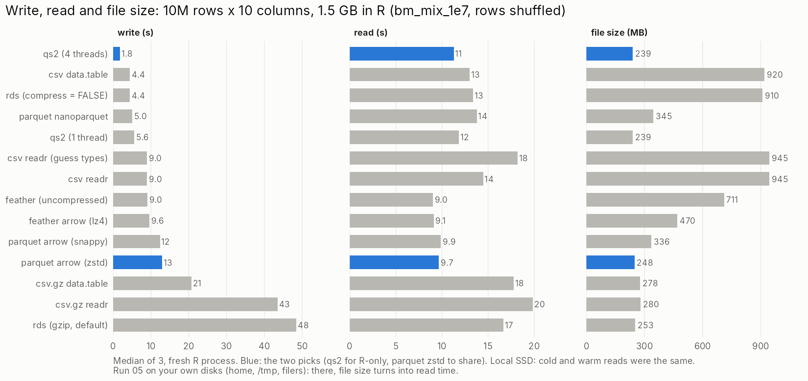

# After collect(): write a file, read it back. Which format?

Script: `05-io-formats.R` → `results/05-io.csv`. 14 ways to write and read, 4 datasets:

- `mix_1e7`: the 10-column survey table (`id`, `age`, `sex`, `prov`, `income`, `wgt`, `ref_date`, `flag`, `name`, `amount`), 10M rows, **1.5 GB in R**. 10M unique `name`s, so it's string-heavy, like most real extracts. `mix_1e6` is the same with 1M rows.
- `int_zero_1e7` / `int_rand_1e7`: 1 int column, 10M rows, all 0 or random 1-2 million. This is your "does all 0s vs random matter" question.

Each step runs in a fresh R process: write, read with the file still in the OS cache ("warm"), and read after evicting the file from the cache ("cold"). That's the median of 3 calls after 1 untimed call. Reads are timed until every value is a real R vector (see [Fair reads](#fair-reads-and-fair-files)). The files went to the sandbox's local SSD.

## Short version

- **For R-only files: `qs2`** (`qs2::qs_save(x, f, nthreads = 4)`, `qs2::qs_read(f, nthreads = 4)`):
  - **the smallest file** (239 MB for the 1.5 GB table);
  - **27× faster to write than `saveRDS()`'s default** (1.8 s vs 48 s; 5.6 s with 1 thread);
  - reads 30% faster than default rds;
  - you get back the exact R object.
  - `qs` itself is archived on CRAN. `qs2` is its successor, by the same author.
- **To share with other tools** (Python, duckdb, Spark, SAS Viya), **or to read only some columns: parquet**, `arrow::write_parquet(x, f, compression = "zstd")`:
  - nearly as small (248 MB);
  - the fastest read here (9.7 s);
  - keeps int, double, Date, logical and text.
  - Writing is slower (12.9 s).
- **Avoid `saveRDS()` with its default gzip** (48 s to write) **and `.csv.gz`** (21 s with data.table, 43 s with readr). `saveRDS(compress = FALSE)` writes fast (4.4 s), but the file is 3.8× the size of qs2.
- **CSV loses types** unless you spell them out:
  - `data.table::fread()` turned the province codes `"10"`-`"22"` into integers (codes like `"01"` would lose their leading zero) and Date into `IDate`;
  - `readr::read_csv()` without `col_types` made `id` and `age` doubles and `prov` a number;
  - with a `col_types` spec, readr kept everything.
  - CSV is also the most memory-hungry: readr peaked at **2.2× the result's size** reading and +1.2 GB writing.
- **Reading back costs about the same in every format: 9 to 20 s** for this table. Most of a read is R making the 10M strings, the same cost `collect()` pays (03). So choose by write time, file size and types kept.
- **All zeros vs random matters a lot here**: 10M ints that are all 0 are **2 KB** in qs2, 20 KB as csv.gz and 9-36 KB as parquet. Random 1-2M: **25 to 45 MB**. Uncompressed rds and feather: 40 MB either way.
- **Cold vs warm file cache made no difference here**, because this disk reads ~2 GB/s: even the 910 MB file costs half a second. On the filers it will make a difference, and **file size is what counts there.** At 100 MB/s, the 910 MB rds would take ~9 s just to arrive, the 239 MB qs2 ~2.4 s. Run 05 there (`BENCH_IO_DIR` pointing at the filers).

## 10M rows × 10 columns (`mix_1e7`, 1.5 GB in R)

Median seconds. "Read peak" is how much the R process's peak memory grew during the first read (MB). The result itself is ~1500 MB.

| format | write | read | file MB | types kept? | read peak |
|---|---|---|---|---|---|
| `saveRDS()` (gzip, the default) | 48.4 | 16.7 | 253 | yes | 1712 |
| `saveRDS(compress = FALSE)` | 4.4 | 13.4 | 910 | yes | 1712 |
| **qs2**, 1 thread | 5.6 | 11.8 | **239** | yes | 1731 |
| **qs2, 4 threads** | **1.8** | 11.3 | **239** | yes | 2234 |
| parquet, arrow (snappy, the default) | 12.4 | 9.9 | 336 | yes | 2348 |
| **parquet, arrow, zstd** | 12.9 | **9.7** | 248 | yes | 2380 |
| parquet, nanoparquet | 5.0 | 13.8 | 345 | yes | 1848 |
| feather, arrow (lz4, the default) | 9.6 | 9.1 | 470 | yes | 2126 |
| feather, uncompressed | 9.1 | 9.0 | 711 | yes | 1671 |
| csv, readr, with `col_types` | 9.0 | 14.5 | 945 | yes | 3216 |
| csv, readr, guessing types | 9.0 | 18.2 | 945 | **no**: `id`, `age` int → double, `prov` → double | 3293 |
| csv, data.table | 4.4 | 13.0 | 920 | **no**: `prov` → integer, Date → IDate | 2285 |
| csv.gz, readr, with `col_types` | 43.5 | 19.9 | 280 | yes | 3215 |
| csv.gz, data.table | 20.7 | 17.8 | 278 | **no** (as csv) | 2291 |

- With 1M rows (`mix_1e6`), everything took 1/10 to 1/14 of this: qs2 (4 threads) wrote in 0.17 s, `saveRDS()` in 5.0 s.
- **The first read in a fresh R session took 1.3 to 1.7 times the median** (rds 21-24 s, qs2 19-20 s, parquet 15 s). Most of that is R's garbage collector running while the heap grows, as with `collect()` (03, 07 part f). A scheduled job that reads one big file sees that number. `R_NSIZE`/`R_VSIZE` help here too.
- **Writing memory:** `saveRDS()`, qs2 with 1 thread and `data.table::fwrite()` need almost nothing extra (1-40 MB). qs2 with 4 threads needs ~300 MB, arrow ~500-580 MB, and **`readr::write_csv()` ~1.2 GB**.
- **Threads:** qs2, arrow and data.table use several cores. In a k8s pod, set the thread count to your pod's CPU limit (`nthreads =`, `arrow::set_cpu_count()`, `data.table::setDTthreads()`): R may see all of the node's cores.
- nanoparquet (no arrow dependency, small install) wrote 2.5× faster than arrow but read 40% slower, at the same file size as arrow with snappy.

## All zeros vs random 1-2 million (1 int column, 10M rows, 40 MB in R)

| format | file, all 0 | file, random | write s, random | read s, random |
|---|---|---|---|---|
| `saveRDS()` (gzip) | 0.04 MB | 31.8 MB | 3.32 | 0.30 |
| `saveRDS(compress = FALSE)` | 40 MB | 40 MB | 0.08 | 0.06 |
| qs2, 4 threads | **0.002 MB** | **25.1 MB** | 0.04 | 0.03 |
| parquet, arrow (snappy) | 0.03 MB | 45.1 MB | 0.26 | 0.03 |
| parquet, arrow, zstd | 0.04 MB | 37.0 MB | 0.38 | 0.07 |
| parquet, nanoparquet | 0.01 MB | 40.0 MB | 0.15 | 0.03 |
| feather (lz4) | 0.2 MB | 40.0 MB | 0.07 | 0.03 |
| csv, data.table | 20 MB | 80 MB | 0.10 | 0.07 |
| csv, readr | 20 MB | 80 MB | 0.19 | 1.54 |
| csv.gz, data.table | 0.02 MB | 35.1 MB | 3.45 | 0.55 |

- Every compressing format shrinks all-0 columns to almost nothing. Random 7-digit numbers barely compress: lz4 gave up and stored them raw (40 MB), and snappy parquet came out *bigger* than the raw data.
- In real survey data, flags, codes and mostly-zero amounts compress well, and IDs and weights don't. So **file sizes depend on your data**, not only on the format.
- Numbers without text are fast in every binary format (≤0.3 s for 10M). `readr::read_csv()` is the outlier: 1.5 s, 20-35× slower than `fread()`.

## Fair reads and fair files

Three things in the script that change the numbers a lot:

- **Lazy strings.** arrow hands back text columns as ALTREP vectors: the R strings are made only when something touches them. `read_parquet()` of the 1M-row table "took" 0.08 s that way, but 0.30 s once the strings exist. The script touches every text column inside the timing.
  - Numbers aren't touched. Uncompressed feather is memory-mapped, so its 10M ints "read" in 0.005 s: they come off the disk only when used. At this disk's speed that's ~0.02 s more.
- **Shuffled rows.** The test tables come from a generator, and in row order their values follow a regular sequence:
  - Compressors love that: qs2 stored the 10M random ints in 1.5 MB in row order, vs 25 MB shuffled.
  - The unique names are `value_00000000000001`, `…02`, …, and R makes such a sequence of strings much faster than strings in random order (see 03's [row order of unique text](03-collect.md#unique-text-the-order-of-the-rows-matters)). `readRDS()` of the same table took **6.9 s in row order vs 15.8 s shuffled**.
  - So the script shuffles the rows first (`set.seed(42)`), which is closer to real data.
- **Cold cache.** Before each "cold" read the file is evicted from the OS cache with `dd if=FILE iflag=nocache count=0` (no root needed). That works here: checked with `/proc/meminfo` and a 1 GB file (0.47 s cold vs 0.13 s warm with `cat`). The disk is just fast.

## Caveats

- This part ran after a restart of the sandbox, on another day than parts 01-04 and 06-07. Compare formats with each other, not with the absolute times of other parts (00 has the run-to-run drift).
- Local SSD. Not your home PVC, `/tmp` in the pod, or the filers: those are the runs that matter (see [run-at-statcan.md](run-at-statcan.md)).
- `fst` wasn't tested (it's fast, but can't store every R type, and the project is barely maintained). `vroom` wasn't tested separately: `readr::read_csv()` uses vroom underneath.
